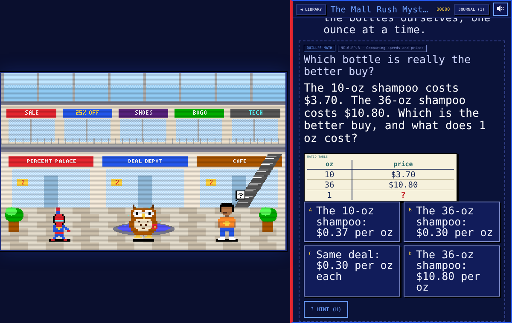

# Page Quest: Rate & Percent Mysteries

**SpiderBen10's special edition · Math 6 Unit 3.** A dev-only edition of **Page Quest** (the
choose-your-own-adventure reading game in SpiderBen10's Arcade) where the story moves when you
solve **Math 6 · Unit 3: Unit Rates and Percentages** problems. Same engine as Page Quest: 80s
Sierra-style pixel scenes with animated sprites, typed-out story text with read-aloud, choices
**A–D** (keys 1–4 / A–D or tap), Quill the owl librarian, the Clue Journal (**J**), checkpoints,
the endings gallery, score and music. Created by **SpiderBen10 (NZDO)** for SpiderBen10's Arcade.



The curriculum source of truth is [`docs/math6-unit3.md`](../../docs/math6-unit3.md) (skills,
sample problems, mistakes to catch, conversion facts, the 18 skill tags, generator rules, design
rules and the out-of-scope list). Standards: **NC.6.RP.2** (unit rate) and **NC.6.RP.3** (ratio
tables, unit-rate problems, percent, unit conversion); scale-factor items are tagged
**NC.7.G.1 (7th-grade bridge)**.

## What's different from Page Quest

- **The shelf shows only the three math books** (no genre tabs). The library and the title card
  say *SpiderBen10's special edition · Math 6 Unit 3*. The regular books and the **Writer's Desk**
  are not shown (the Writer's Desk code is still in `src/ui/WriterDesk.tsx`). **HOW TO PLAY** opens
  *Quill's Math Warm-Up* (`src/stories/sample/tutorial.story`).
- **Math gates with fresh numbers.** A gate in a `.story` file names a generator; the question,
  its 4 choices and the answer are made at play time by pure TypeScript (`src/math/`), so the
  numbers are new on every read and every answer is computed in code.
- **Gentle rules:** no hearts at any grade. A wrong answer never costs anything and never ends the
  story: Quill names the mistake (*"That's the discount. What does the customer pay?"*), and you
  try again. **HINT** (or **H**) shows Quill's nudge, then a worked step; hints used are recorded.
  No timers. (Choice-made lose endings, like chasing the Phantom, are *detours* back to the
  checkpoint.)
- **Show the model:** rate and percent questions draw a small **double number line**, **tape
  diagram** or **ratio table** (SVG, `src/ui/MathModel.tsx`) next to the question, with **?** at
  the unknown.
- **Story problems (chains, 2–4 steps):** Quill first asks for the FINAL answer, with wrong choices
  built from the earlier steps' values (the subtotal, the before-tax price...). Right on the first
  try = **+150 bonus** and a gold-star clue in the journal. A miss breaks the problem into its
  steps: each step is its own question with its own skill tag, a **work so far** list stays on
  screen, and the last step asks for the final answer again.
- **Results:** the ending's mission report shows each **skill tag** with *right on the first try /
  total* and *hints used*; **Redo the ones I missed** starts a quick round in the library (Quill
  asks one fresh question per missed skill tag); **EXPORT CSV / EXPORT JSON** download the saved
  answers (date, game, book, skill tag, standard, question, answer given, correct answer,
  correct/incorrect, hints used). The library also offers the redo round and the exports.
- **Saves** use their own keys (`pqRates.*`, kit progress under `page-quest-rates`), so this
  edition never shares saves with Page Quest. The attempt log keeps the newest 500 answers.
- Checkpoints still bring Quill's reading **transmission** (an ELA question from the kit bank).
- Two new scenes: `mall` (the Grand Bazaar Mall: shop signs, an escalator, a fountain) and
  `desert-tower` (a giant stepped tower over a desert city, with heat shimmer).

## The books

| Book | Pages | Math gates | Chains | Skills |
|---|---|---|---|---|
| **The Mall Rush Mystery** (mystery, `mall`): catch the Price Phantom by catching the price-math mistakes | 29 | 12 | 4 (receipt, tip split, bulk-bin change, sale + tax) | deals per ounce, percent of / whole / percent, tape diagrams, benchmarks, per 100, discounts, coupons, tax, tips |
| **The Needle of the Dunes** (adventure, `desert-tower`): climb the giant Skyneedle and light the beacon before sunset (the Burj Khalifa, 828 m, is its real-world cousin) | 20 | 12 | 3 (water for the climb, climb time vs. sunset, race by pace) | estimating with rates, sensible units, conversions both ways (length, weight, volume), two unit rates, same rate?, double number lines, speed vs. pace |
| **Paint the Room, Robot Crew!** (robots, `robot-workshop`): a robot paint crew paints the art room, then a copy-machine bonus chapter | 20 | 10 | 5 (wall area, gallons ×2, buying paint + tax, copy area) | wall area − door/window, coats, gallons rounded UP, the cheap-per-gallon trap, price + tax, batches with fractions, scale factors (bridge) |

Together the books reach all **18 skill tags** (`npm test` checks this). Every book has
checkpoints, a win and a secret ending, and reads at a grade 6–8 level (Flesch–Kincaid 6.1–7.5).

## Writing math gates (`.story` format)

Everything in the Page Quest `.story` format still works. A math gate replaces the `? RL.3 : ...`
gate:

```
? MATH sale-price item=jacket : What should a shopper really pay for one jacket?
next: palace-2

? MATH chain:receipt who=Mrs._Lund item=striped_scarves : Work out what the receipt total SHOULD be.
bonus: You checked the receipt in one go!
next: scarf-2
```

- The text after `:` is the story's lead-in, shown above the generated question.
- `key=value` parameters theme the question (underscores become spaces). The validator rejects
  unknown generators, unknown chains and unknown parameters, and `+`/`-` answer lines.
- `bonus:` (chains only) is the journal clue for solving the chain on the first try.
- `hint:` is not needed: every generated question has its own two hints.

**Generators** (`src/math/unit3.ts`, skill tag number from the doc in brackets):
`estimate-rate` theme=windows|steps|floors|lights|bricks [1], `pick-unit` [2],
`convert-length`, `convert-weight`, `convert-volume` thing, dir=up|down, pair [3],
`deal-compare` item, unit and `speed-compare` [4], `two-rates` item, unit [5],
`same-rate` a, b, unit, thing [6], `pace-vs-speed` [7], `unit-price-total`, `batch-scale` ing, unit, what [8],
`percent-rate` [9], `percent-dnl` [10], `percent-tape` [11], `benchmark-percent` [12], `percent-of` [13],
`percent-whole` what, done, over=no [14], `percent-find` [15], `sale-price`, `sales-tax`, `tip` [16],
`paint-area`, `paint-gallons`, `paint-cost` [17], `scale-copy`, `scale-area`, `scale-drawing` [18].

**Chains** (`src/math/chains.ts`): `receipt`, `sale-tax`, `tip-split` (Discounts, tax, and tips),
`deal-total`, `climb-time`, `race-pace`, `water-trip` (Multi-step rate problems), `wall-area`,
`paint-gallons`, `paint-buy` (Multi-step project), `copy-area` (Bridge: scale factors).

Generator rules followed (doc section 6): clean answers; money always with 2 decimals and some
round-to-the-cent items; percents mostly multiples of 5 and benchmarks plus 6%, 12%, 35% and over
100%; at least 1 in 4 items two-step (only the final answer accepted); conversions in both
directions about equally; fractions 1/2, 1/3, 1/4, 2/3 and 1 1/2 in batch and rate items; 4
different choices whose wrong answers come from real mistakes (the step-one answer, the flipped
division, the misplaced decimal, the unrounded or chopped value), each with feedback that names
the mistake. Nothing from section 10 (out of scope).

## Run it locally

```sh
npm install
npm run dev        # http://localhost:8080
npm run build      # type-check (strict) + production build into dist/
npm test           # story tests, math tests, book checks, music checks
```

`npm test` runs:

- `scripts/test-story.ts`: the Page Quest parser/validator/serializer/session tests (with this
  edition's gentle rules);
- `scripts/test-math.ts`: thousands of questions per generator and chain (`N=` sets how many).
  Every answer is checked against an independent recomputation; 4 unique choices with the right
  one present; named mistakes and two hints that never give the answer away; money with 2
  decimals; no negatives; ≥ 25% two-step; conversions balanced; 6/12/35% and >100% present; every
  chain's steps recompute to the final answer and the final answer's wrong choices include each
  earlier step's value; the gentle gate rules; the `? MATH` syntax; the attempt log and export;
- `scripts/check-stories.ts`: every book validates (math gate ids must exist); 20–30 pages, 8–12
  math gates, 3+ chains, checkpoints, win + secret endings, grade 6–8 reading level and ≥ 25%
  two-step items per book; all 18 skill tags reachable; no out-of-scope words and no private
  names anywhere in `src/` or the books;
- `scripts/check-music.ts`: the soundtrack (same songs as Page Quest).

`scripts/playtest.cjs` is a Playwright playtest of the built game (start
`npx vite preview --port 8911 --host 127.0.0.1` first) at desktop 1280×800 (keyboard) and phone
390×844 (touch): it reads *The Mall Rush Mystery* to its win ending, answers a math gate wrong
then right with both hint stages, misses a chain and works through its steps, solves chains first
try, checks the skill report, both exports and the redo round, then reads the other two books to
an ending; it also checks the toolbar above the overlay, tap target sizes, no horizontal scroll
and no page errors. `SHOT=1` saves `docs/screenshot.png`,
`docs/scene.png` and the arcade menu image `site/img/page-quest-rates.png`.

Code map: `src/math/` (skill tags, formatting, generators, chains, gate rules, attempt log and
export), `src/ui/MathGate.tsx`, `src/ui/MathModel.tsx`, `src/ui/RedoRound.tsx`, plus the Page Quest
engine (`src/story/`, `src/play/`, `src/engine/`, `src/ui/`). `src/kit` is the shared arcade kit
(an identical copy of the canonical `kit/` folder).

## Deploying

Dev only: the entry in `site/games.js` has no `prod` field, so the arcade's deploy builds and tests
it for the dev site at `/page-quest-rates/`, and production skips it.

## Credits

Game design and characters: **created by SpiderBen10 (NZDO)**. Quill, the cast and every scene are
original pixel art drawn in code; the music is Page Quest's original soundtrack. No trademarked
characters or places (the Burj Khalifa is mentioned as a real landmark).
