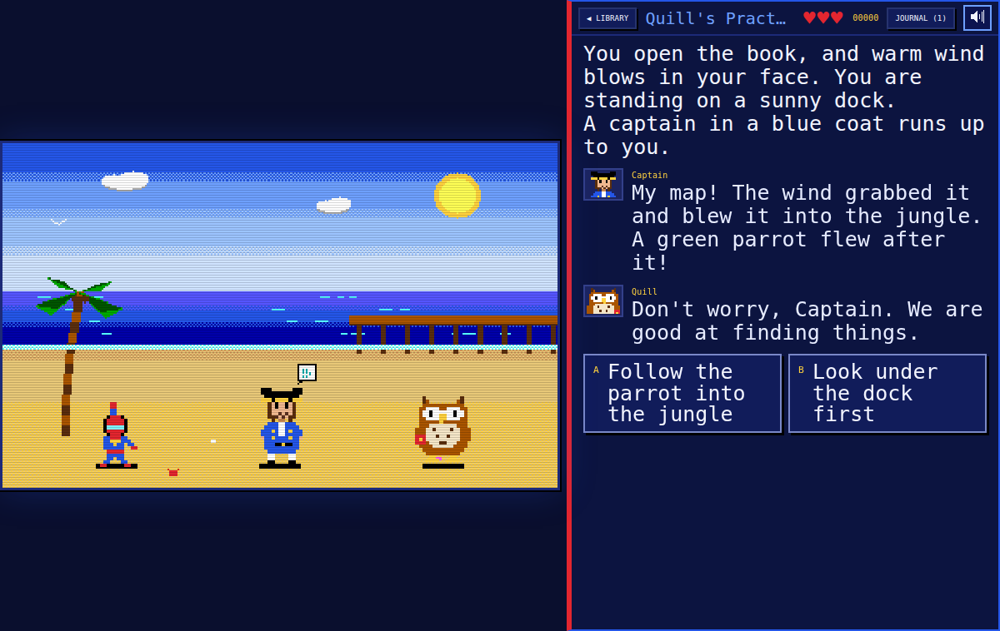

# Page Quest

**Page Quest · co-authored by SpiderBen10 (NZDO)**, created by **SpiderBen10 (NZDO)** for
**SpiderBen10's Arcade**. A choose-your-own-adventure reading game for grades 4–12 in the style of
80s Sierra/LucasArts adventure games: a 320×200 pixel scene with the characters on screen, and the
story below it (or beside it on wide screens) in big VT323 text, with read-aloud.



- **The Arcade Library** is the hub: a pixel library with **Quill**, the owl librarian (she gives
  the hints), the arcade's hero, and a bookshelf with **MYSTERY / ADVENTURE / SPACE / FANTASY / SPOOKY / ROBOTS** sections
  plus **MY BOOKS** (books written in the Writer's Desk). Every genre has at least one book for each band,
  grades 4–5, 6–8 and 9–12 (a genre with no book yet shows an empty shelf message); the **ROBOTS** tab
  (teal spines, a little pixel robot-head icon) has two books per band. Spines are tagged **YOUR LEVEL**, **EASY READ** (lower band) or **CHALLENGE** (higher band,
  still playable); your level's book is selected. The detail card shows the cover scene, blurb,
  reading level, and **endings found (x / y)**, with READ, or CONTINUE / START OVER for a book in
  progress (the current page is saved per book).
- **Subject row** (like the other arcade games): **MIXED** (the default) · **READING** · **MATH** ·
  **SCIENCE** · **SOCIAL STUDIES**, under the library header. The story gates written in the books
  always test the book; the subject picks Quill's **quick challenges** (`? QUIZ` gates, see below) and
  the checkpoint **transmissions**, drawn from the shared kit question banks at the player's grade
  (READING = the ELA bank; MATH = the kit's generated math at the player's adaptive math level, like
  Dojo Tower; MIXED takes turns math → science → reading → social studies across the whole read).
  The choice is saved in `arcade.page-quest.subject`. From the arcade menu, `?topic=` picks a subject
  for that visit (`math-mix` → MATH, `science-mix` → SCIENCE, `social-mix` → SOCIAL STUDIES, `ela-mix`,
  `reading` or `writing` → READING; `?subject=mixed|reading|ela|math|science|social` works too); topics
  inside a subject (fractions, life science...) are not offered, so the menu only links whole-subject mixes.
- **Reading:** each page draws its scene (37 procedurally drawn EGA-style backgrounds, animated:
  waves, torches, stars, lasers, rain, scrolling train windows, cryo-bay mist, drifting magic letters,
  a radar sweep, conveyor belts, a scoreboard clock, welding sparks, reef fish, kelp and bubbles,
  glowing deep-sea jellyfish...) with up to three
  characters (38 original sprites with idle bobbing, blinking, moods on the face and in emote bubbles
  ♥ … ! ? ❄ and friends; the `frozen` mood turns any character to ice and holds them still). The text types out (tap, Space or Enter skips); dialogue lines show the speaker's
  portrait while their sprite bobs and talks. Then pick a choice **A–D** (keys 1–4 / A–D or tap).
- **Gates** are Quill's skill questions inside the story: multiple choice (answers shuffled) or
  **put in order** (tap the torn map / diary pieces in the order they happened). Each gate is tagged
  with the NC standard for your grade (anchor `RL.3` → `RL.7.3` at grade 7) and recorded in the kit's
  per-standard progress.
- **Quick challenges** (`? QUIZ` gates) sit between scenes in every book (2–3 per book, usually at the
  chapter breaks; 1 in the HOW TO PLAY book). Quill flutters in ("Before we go on, a quick
  challenge!") and asks a question from the chosen subject at the player's grade (the header shows
  QUICK CHALLENGE, the subject and the bank item's own standard, e.g. `PS.7.2.2`). Answers 1–4 / A–D or
  tap. Quill's hint after a miss, and the note after a right answer, is the bank item's own
  explanation. The question is kept in the book's save, so CONTINUE shows the same one. It is
  recorded in the kit's progress by its standard (math also moves the adaptive math level) and shown in
  the mission report as *quick challenges*.
- **Losing (by the player's grade, not the book's):**
  - **Grades 6–12:** a **COURAGE** meter of 3 hearts. A wrong answer costs a heart and shows Quill's
    hint; try again. This includes quick challenges: a wrong subject answer costs a heart like any
    other gate (one rule for every question; the hint is the item's explanation, so the retry is fair). At 0 hearts: **THE END?** → *Try again from checkpoint* (full hearts). The 6–8 and
    9–12 books also have **lose endings** (the thief escapes, the ship drifts off course...), with
    *Try again from checkpoint*.
  - **Grades 4–5:** no hearts, nothing is lost. First miss: Quill's hint. Second miss: Quill shows
    the right answer and the story goes on (story gates and quick challenges alike). If a grade 4–5 player reads a harder book and reaches a
    lose ending, it becomes a **DETOUR**: the page is read, the ending is added to the gallery, and
    Quill flies you back to the checkpoint.
- **Checkpoints** (`checkpoint` pages) also bring an **incoming transmission from Quill**: a question
  from the chosen subject's kit bank (MIXED takes turns; the tag shows MATH / SCIENCE / READING /
  SOCIAL STUDIES) with its explanation (+50 points; grades 6+ also win back a heart).
- **Clue Journal** (**J** or the JOURNAL button) lists the clues collected in this read.
- **Endings:** win, lose and **secret** endings. The ending screen shows the ending's name and type,
  the book's **endings gallery** (saved per browser), your score (gates right first try +100, later
  +25, win +300, secret +300 **+500 secret bonus**, a new ending +200, transmissions +50; high score
  via the kit), and a **mission report** by standard (code + skill, first-try results) with
  **practice next**.
- **HOW TO PLAY:** `src/stories/sample/tutorial.story` is a short practice book (10 pages, one
  gate of each type including a quick challenge, a win and a secret ending). It opens from the HOW TO PLAY button; it only shows
  inside its genre on the shelf when that genre has no real books yet.
- **Grades K–3** see a friendly *"Page Quest is for grades 4 and up"* screen with the ◀ ARCADE link.

## Writer's Desk (SpiderBen10 is the co-author)

From the library, **✎ WRITER'S DESK** opens an editor for your own books (desktop and iPad):

- Several drafts, saved in this browser (NEW / DELETE, pick from the list).
- **Book:** title, author, genre, band, cover scene, blurb (with a 120-character counter), start page.
- **Pages:** list, add, delete, rename (links follow the new name). Per page: scene and up to three
  cast members with moods (dropdowns, with a **live preview** of the scene), checkpoint, clues, the
  story text (blank line = new paragraph, `Quill: words` = dialogue, `~ Chapter Two ~` = heading),
  and how the page ends: **choices** (text + a target page from a dropdown, or *+ new page…*), a
  **question gate** (multiple choice or put-in-order, the standard anchor, Quill's hint, the next
  page; or a **quick challenge** from the reader's subject, with Quill's lead-in and the next page),
  or an **ending** (win / secret / lose, lose only for 6-8 and 9-12).
- A **live validator** (the same one `npm test` uses; click a problem to jump to its page) and a
  **reading-level meter** (Flesch–Kincaid grade against the band).
- **PLAYTEST** from the current page or from the start (drafts don't touch your endings gallery).
- **EXPORT** downloads the `.story` file; **IMPORT** loads one (file picker) and **PASTE** takes pasted text.
- Drafts appear on the shelf under **MY BOOKS · by SpiderBen10**.
- Typing in the editor never triggers game keys (A–D, J, P, M...).
- The scene and cast dropdowns come from the roster, so the ocean scenes and the sharks are there too.

### Shipping a book you wrote (so everyone gets it)

1. In the Writer's Desk, make sure the CHECK panel says **READY ✔**, then press **EXPORT**. You get
   a file such as `the-cave-of-echoes.story`.
2. Put it in the game's `src/stories/` folder, in the folder for its band:
   `src/stories/4-5/`, `src/stories/6-8/` or `src/stories/9-12/` (for example
   `games/page-quest/src/stories/6-8/the-cave-of-echoes.story` in the arcade repository). Any file
   name ending in `.story` works; the book's genre and band come from its header.
3. Run `npm test` (it checks every book and prints its reading level) and `npm run build`.
4. Commit and push; the arcade's deploy publishes it. The book appears on the shelf for everyone, in
   its genre, with the author name from its header (use `author: SpiderBen10`).

Books can also be written by hand in any text editor, in the format below.

## The `.story` format

Plain UTF-8 text: a header (`title`, `author`, `genre` mystery|adventure|space|fantasy|spooky|robots, `band`
4-5|6-8|9-12, `cover` scene id, `blurb` ≤ 120 characters, `start` page id), then pages starting with
`=== page-id`. Each page has `scene:`, optional `cast:` (0–3 characters, `id[:mood]`),
`checkpoint`, `clue:` lines, body text and ends with ONE of: 1–4 choices (`> text -> page-id`, text ≤
48 characters), a gate (`? RL.3 : question` with 2–4 `+`/`-` answers ≤ 70 characters and exactly one
`+`, or `? RL.5 order : question` with 3–5 numbered items; then `hint:` and `next:`), a **subject
gate** (`? QUIZ : lead-in` then `next:`), or `end: win|lose|secret Ending Name`. `#` lines are comments. The full contract is in the Page Quest
design brief (`PAGE_QUEST.md`); scenes and characters are listed in `src/story/roster.ts`.

**Subject gates (`? QUIZ`).** An addition to the brief, so books can ask questions from every
subject:

```
=== quiz-chapter2
scene: research-boat
cast: hero, quill:happy
Quill hops onto the railing and pulls a tiny card out from under her wing.
Quill: Hoo! Divers need sharp minds.
? QUIZ : Before we dive, a quick challenge!
next: chapter2
```

The lead-in after the colon is optional (Quill says "Before we go on, a quick challenge!"). A QUIZ
gate has no answers, items or standard of its own: the question comes from the reader's subject at
play time. `+`/`-` answers or numbered items under it are errors; a `hint:` line is a warning (unused);
`next:` is required. Put QUIZ gates between scenes (chapter breaks are ideal), not in the middle of a
clue, so the subject question never interrupts the story's own reasoning. `npm test` wants 2–3 per
shelf book.

**How this engine reads the parts the brief leaves open** (the most lenient reasonable reading):

- **Moods not in the list** that writers commonly use are accepted with a warning and shown as the
  nearest mood (the brief's own example uses `captain:worried` → *scared*; also nervous/afraid →
  scared, upset → sad, mad → angry, shocked → surprised, confused/curious → thinking,
  excited/proud → happy, calm/neutral → normal, icy/iced → frozen). Other unknown moods are errors.
- **Dialogue:** a line `Name: words` is dialogue only when *Name* is a roster display name; any other
  `Word: text` line is narration. A roster character who speaks without being in `cast` is a warning
  (the line still shows their portrait); `Hero:` lines are a warning (the hero never talks).
- **Paragraphs:** consecutive body lines stay separate lines inside one paragraph (poems, logs); a
  blank line starts a new paragraph. `~ Chapter Two ~` lines are headings.
- **`clue:`, `scene:`, `cast:` and `checkpoint`** may appear anywhere in the page. Story text after
  the choices/gate/ending is still shown, with a warning.
- **Choices** split on the **last** `->` (so the text may contain `->` or quotes); `→` also works.
- **Anchors** written with a grade (`RL.7.3`) are normalised to `RL.3` with a warning. Order items
  may be written `1 text`, `1. text` or `1) text`; out-of-sequence numbers are a warning (file order
  is used), and item text may itself start with a digit.
- **Gates** count as the page's way forward (`next:`); a page with no choices, gate or ending is an
  error, and so is any page that can be read but can never reach an ending (a loop with no exit).
- **Reading level** is the Flesch–Kincaid grade of all narration, dialogue and headings (speaker
  labels and clues excluded; "Mr./Mrs./Ms./Dr." don't end sentences; "..." is a pause).
- **Books with errors** are left off the shelf (a console warning says so); `npm test` fails on them.
- A **lose ending reached by a grade 4–5 player** (only possible in a CHALLENGE book) is a detour,
  as described above.
- **RF anchors** (foundational skills) end at grade 5; from grade 6 up, `RF.3` is reported as `L.x.4`
  and `RF.4` as `RL.x.10` (see *Codes to verify*).

### Roster (scenes, characters, moods)

The Writer's Desk dropdowns and the validator read these from `src/story/roster.ts`, so a new entry
there (plus its art in `src/engine/scenes.ts` / `sprites.ts`) shows up everywhere.

**Scenes (37):** `library` (the Arcade Library hub), `beach`, `ship-deck`, `island-jungle`, `cave`,
`castle-hall`, `forest`, `village`, `mountain-pass`, `space-bridge`, `space-corridor`,
`planet-surface`, `museum-hall`, `museum-vault`, `city-street`, `lab`, `lighthouse`, `stormy-sea`,
`school`, `train`, `cryo-bay` (a frosty space-station cryo bay: frozen sleep pods, icicles, an icy
floor, drifting cold mist), `academy-hall` (the great hall of a hidden school of magic: bookshelves,
a rose window with an open book, ? and ! study-group banners, glowing letters drifting upward),
`secret-hq` (a spy headquarters under a school: wall map with blinking dots, radar sweep, monitors,
lockers, briefing table), `temple-ruins` (a ruined Greek temple on a sunny hill above the sea, olive
trees, a gull), `labyrinth` (stone maze corridors with torches and a red thread along the floor),
`castle-night` (a cozy candlelit castle hall at night: candelabras, portraits, cobwebs, bats at the moonlit window),
`pumpkin-patch` (a moonlit pumpkin patch with glowing jack-o'-lanterns, a friendly scarecrow and fireflies),
`attic` (a dusty attic: a round moon window, trunks, boxes, a dress form, a rocking horse),
`robot-workshop` (a robot workshop: pegboard of tools, a BOT-7 blueprint, parts bins, a half-built robot on the bench, a swinging lamp, welding sparks),
`factory-floor` (the ROBOWORKS factory: conveyor belt with boxes, bobbing robotic arms, wall gears, hazard stripes, spinning warning lights),
`robot-arena` (a robot competition arena: cheering bleachers doing the wave, team banners, a scoreboard with a ticking clock, sweeping spotlights, a ramp),
`recycling-center` (a sunny recycling center: CANS / PAPER / GLASS / CUPS bins, a sorting belt, bales, a gliding seagull),
`rooftop-night` (a city rooftop at night: skyline windows, water tower, blinking antenna, a BEEP/BOOP billboard, shooting stars),
`bakery` (a bakery kitchen: a glowing brick oven, an awning window, shelves of bread and cakes, a mixing bowl with steam),
`reef` (an underwater coral reef: sunlight rays from the surface, brain and branching corals, a purple sea fan, tube sponges, swaying kelp, little fish darting past in schools, rising bubbles),
`research-boat` (a marine research boat at sea: white wheelhouse with a radar dome, an orange A-frame crane at the stern, tagging gear, a laptop on a folding table, a life ring, gulls, a marker buoy bobbing on the waves),
`deep-sea` (the deep sea: dark water, a seamount, drifting marine snow, pulsing glowing jellyfish, lanternfish lights, sea pens and a submersible's searchlight).

| id | dialogue name | who |
|---|---|---|
| hero | Hero | the player (never has dialogue lines) |
| quill | Quill | the owl librarian sidekick (she) |
| kid | Kid | a kid about the player's age |
| captain | Captain | a ship captain |
| parrot | Parrot | a talkative parrot |
| robot | Robot | a friendly boxy robot |
| scientist | Scientist | a scientist in a lab coat |
| detective | Detective | a detective in a trench coat |
| guard | Guard | a guard / security officer |
| keeper | Keeper | an old lighthouse/museum keeper |
| ghost | Ghost | a friendly-ish ghost |
| dragon | Dragon | a small dragon |
| knight | Knight | a knight in armor |
| mayor | Mayor | a town mayor |
| cat | Cat | a cat (talks in fantasy books, otherwise meows) |
| stranger | Stranger | a hooded mysterious figure |
| alien | Alien | a friendly alien |
| zombie | Zombie | a goofy green-tinged space zombie in a mossy suit with a glowing spore mushroom (cartoon, never gory; curable) |
| astronaut | Astronaut | an astronaut in a white spacesuit with orange stripes and a clear faceplate |
| mentor | Mentor | a kind but strict teacher of magic in an ink-blue robe, with a lantern staff |
| agent | Agent | a spy instructor in a dark suit and red tie, sunglasses up, earpiece wire |
| sphinx | Sphinx | a riddle-loving sphinx: lion body, feathered wings that lift, a woman's head |
| griffin | Griffin | a griffin: white eagle head, golden beak, flapping brown wings, lion body |
| minotaur | Minotaur | a gentle young minotaur: calf's head, small horns, blue tunic, a red flower |
| vampire | Vampire | a friendly cartoon vampire: slicked hair, lilac skin, one tiny fang, black cape with red lining (never bites) |
| bat | Bat | a small, chatty purple bat with yellow eyes (floats, flaps) |
| werewolf | Werewolf | a fluffy, goofy werewolf with a red bandana (more puppy than scary) |
| helperbot | Helperbot | a round orange helper robot: dark screen face with glowing cyan eyes, heart light, stubby arms, one wheel |
| retrobot | Retrobot | a tall, boxy retro tin robot: silver head with ear bolts, two coil antennas, red body with a dial and buttons, claw hands, square boots |
| drone | Drone | a tiny quadcopter robot with spinning rotors (two frames), a blue shell, a screen face and a camera light (floats) |
| rover | Rover | a six-wheeled rover robot: white camera head with a wide green-eyed screen on a mast, solar wing, parcel hatch |
| fixbot | Fixbot | a spider-legged repair robot: yellow dome with a hazard light, dark visor with orange eyes, wrench and screwdriver arms |
| mech | Mech | a big, friendly construction mech: orange hard hat with a beacon, cockpit-window face, hazard stripes, grabber hands |
| robodog | Robodog | a robot pet dog: silver body, blue ear flaps, green LED eyes, red collar with a gold tag, an antenna tail that wags |
| whaleshark | Whaleshark | a gentle whale shark, the biggest fish in the sea: blue-grey with white spots, pale belly, wide mouth at the front (drawn 3× size, swims, tail swish) |
| hammerhead | Hammerhead | a bronze-grey hammerhead shark: tall dorsal fin, the wide "hammer" head with an eye at each end (2× size, swims) |
| greatwhite | Greatwhite | a great white shark: slate-grey back, white belly (countershading), pointed snout, a calm closed-mouth smile; never gory, no teeth (2× size, swims) |
| biologist | Biologist | a marine biologist in a teal wetsuit with an orange zip stripe, a dive mask pushed up on her head, a ponytail and yellow fins |

Sharks are side-on, facing right like the other animals (the last cast member is mirrored), and are
drawn bigger with the sprite's `scale` (a whole-number multiple of the normal pixel size); all of them
show every mood, including `frozen`. Sharks never talk in the shark books (they are real animals);
people talk about them.

Robots whose faces are screens use `brow` in their face data, so their eyebrows glow in the screen colour (angry,
sad and scared still read clearly); every robot shows all eight moods, including `frozen`.

**Moods:** `normal happy sad angry scared surprised thinking frozen`. `frozen` works on any
character: the sprite is recoloured in ice blues with crystal glints, eyes shut, inside a
see-through ice block, with no idle bob (a ❄ emote bubble shows now and then).

## Grades and standards

Gates are written with a standard anchor; the game reports it at the player's grade. Quick challenges
(`? QUIZ`) and the transmissions come from the chosen subject's kit bank for the player's grade and
are reported with the bank item's own NC code (e.g. `NC.7.RP.2`, `PS.7.2.2`, `7.H.1.1`, `RL.7.1`).

| Grade | Books | Gate codes (anchors used in the books) | Losing |
|---|---|---|---|
| K–3 | — ("for grades 4 and up" screen) | — | — |
| 4 | 4–5 YOUR LEVEL; 6–8 and 9–12 CHALLENGE | RL.4.1–RL.4.6, RI.4.1, RI.4.3–RI.4.5, L.4.1, L.4.2, L.4.4, L.4.5 | never: hint, then the answer is shown |
| 5 | same | RL.5.x, RI.5.x, L.5.x | never |
| 6 | 6–8 YOUR LEVEL; 4–5 EASY READ; 9–12 CHALLENGE | RL.6.1–RL.6.6, RI.6.1, RI.6.2, L.6.1, L.6.4, L.6.5 | 3 hearts, checkpoints, lose endings |
| 7 | same | RL.7.x, RI.7.x, L.7.x (e.g. RL.7.3 characters, setting & plot) | same |
| 8 | same | RL.8.x, RI.8.x, L.8.x | same |
| 9–10 (English I–II) | 9–12 YOUR LEVEL; others EASY READ | RL.9-10.1–RL.9-10.6, RL.9-10.9, RI.9-10.6, RI.9-10.8, L.9-10.1, L.9-10.2, L.9-10.4, L.9-10.5 | same |
| 11–12 (English III–IV) | same | RL.11-12.x, RI.11-12.x, L.11-12.x (e.g. RL.11-12.3) | same |

Skills by anchor: RL.1 cite text evidence, RL.2 theme & summary, RL.3 characters, setting & plot,
RL.4 word meaning & tone, RL.5 story structure & order, RL.6 point of view, RL.9 compare stories,
RI.1–RI.9 the informational-text versions (main idea, text structure, author's purpose, claims &
evidence...), L.1 grammar, L.2 capitals/punctuation/spelling, L.4 word meaning from clues, L.5
figurative language, W.1–W.3 opinion/informative/narrative writing.

The 32 books on the shelf now (`npm test` output; plus the HOW TO PLAY sample): 4–5 books read at
Flesch–Kincaid grade 3.0–4.1, 6–8 books at 5.9–7.0, 9–12 books at 8.2–10.4; 27–44 pages each, 10–18 story
gates plus 2–3 quick challenges, 3–6 endings. Fantasy: *The Jar of Lost Stories* (4–5, Greek myths and the English words they gave us) and
*The Fading Word of Briarwick* (6–8, a hidden school where spells need correct grammar).

**Shark adventures** (ADVENTURE shelf, one per band; sharks are respected and cool, nobody gets bitten;
`npm test` checks each has a shark, an ocean scene, 8+ story gates, 2–3 quick challenges, reachable win
and secret endings, lose endings only for 6–8 and 9–12, and names used in no other book):

| Band | Book | Pages · gates · endings | Reading level | Shark facts and skills |
|---|---|---|---|---|
| 4–5 | *Speckle and the Reef Rescue* — a young whale shark is tangled in a ghost net at Turtle Rock Reef; dive with a marine biologist to free her (secret: her spots match a photo from long ago) | 27 pages · 12 + 1 order story gates, 2 quick challenges · 2 win, 1 secret | FK 3.3 | whale sharks (biggest fish, filter feeders, spot patterns like fingerprints), nurse sharks resting and pumping water over their gills, hammerhead heads, ghost nets, coral fragments; dive safety steps in order, similes, context clues, theme |
| 6–8 | *The Tracker Before the Storm* — a great white's pop-up satellite tag released early; read the drift data, take radio bearings and find it in a weed line before a storm | 30 pages · 13 story gates, 3 quick challenges · 2 win, 2 lose, 1 secret | FK 6.6 | pop-up archival tags, countershading, deep dives, scalloped hammerhead schools at seamounts and their electric sense, sharks vs. people (claims & evidence), sargassum; data tables, point of view, theme (careful courage) |
| 9–12 | *The Silence at Corvina Seamount* — acoustic receivers on a seamount go quiet; rule out equipment and low oxygen, dive in a submersible, and build a case fair enough to protect the mountain (secret: a lanternshark nursery) | 31 pages · 13 + 1 order story gates, 3 quick challenges · 2 win, 2 lose, 1 secret | FK 8.7 | bluntnose sixgills, scalloped hammerheads, acoustic telemetry and sync tags, bioluminescence, marine snow, lanternshark counter-illumination, vessel transponders; claims vs. evidence, comparing sources, tone, word roots, rhetoric |

**Robots** (two per band; every main character's name is unique across all books, which `npm test` checks):

| Band | Book | Robots | Skills |
|---|---|---|---|
| 4–5 | *Dumpling Learns to Bake* — a sweeping robot bakes a lemon cake for a sick baker, taking every recipe word literally | Helperbot (Dumpling), Drone (Whirligig), Fixbot (Widget) | word meaning in recipes, steps in order, character feelings, theme (mistakes help you learn) |
| 4–5 | *Sprocket Takes Everything Literally* — a lightning-zapped robot dog takes idioms literally on the day of the talent show | Robodog (Sprocket), Mech (Hoist) | idioms / figurative language, reading a sign, sequence, theme |
| 6–8 | *The Rescue Relay* — a robotics club's spider-legged bot keeps falling in the water; copy the champions or read the test log? | Fixbot (Skitter), Retrobot (Clatterbox), Mech (Bulwark) | test-log data, iterate, tripod gait text, point of view, gracious competition |
| 6–8 | *Tumble's Long Way Home* — a delivery rover with a broken GPS learns to read a paper map | Rover (Tumble), Drone (Zephyr) | map legend, compass, grid squares, scale, directions in order, the North Star |
| 9–12 | *The Tidewright of Gannet Cove* — an ocean-cleanup mech, a lighthouse keeper's logbooks and a town vote | Mech (Halyard), Drone (Petrel) | claims & evidence, data, metaphor, author's purpose, theme (fix the source) |
| 9–12 | *The Quiet Update* — a factory helper robot that collects words faces a memory-wiping update | Helperbot (Tess) | AI ethics: evidence-based advocacy, the Ship of Theseus allusion, tone, counterarguments |

### Codes to verify

The official NC DPI site is blocked in this sandbox. Codes follow the kit's forms and its notes
(`src/kit/banks/ela/NOTES.md`): RL/RI/L/W numbering from grade 3 up is assumed to match the Common
Core anchors, which NC's 2017 ELA standards keep.

- **RL.x.7 / RL.x.8:** RL.8 does not exist for literature (the validator warns); RL.7 (media) is allowed.
- **RF.3 / RF.4 at grades 6–12** are reported as **L.x.4** and **RL.x.10**; NC's RF strand ends at
  grade 5. RL.x.10 (range of reading) is assumed to exist in NC as in the Common Core.
- **W.1–W.3** as gate anchors: NC reorganised some writing standards in 2017; W.x.1–W.x.3 are assumed.

## Controls

| Keyboard | Touch | Action |
|---|---|---|
| Space / Enter, or click the scene | tap the scene or the text | Show the whole page at once |
| 1–4 or A–D | tap | Pick a choice / answer a gate |
| A–E or 1–5 | tap the pieces | Order gates: pick the pieces in order |
| Enter / Space | CONTINUE / THE END buttons | Continue after a gate, finish an ending |
| J | JOURNAL | Clue Journal |
| R | speaker button | Read the page (or question) aloud |
| ← → , Enter | tap a spine, READ | Library: pick a book, read it |
| P / Esc, M | toolbar | Pause, mute |

The toolbar has **◀ ARCADE** (back to the arcade, keeping the grade), PAUSE, SOUND and READ ALOUD
(off by default for grades 4+; the choice is remembered). When the game is opened from the arcade
with `?grade=`, the library shows that grade and *CHANGE GRADE IN THE ARCADE*; otherwise it has a
K–12 picker.

## Run it locally

```sh
npm install
npm run dev        # http://localhost:8080
npm run build      # type-check + production build into dist/
npm test           # parser/validator unit tests + checks every src/stories/**/*.story
```

`npm test` runs `scripts/test-story.ts` (parser, validator, serializer round-trip, Writer's Desk
draft round-trip, readability, standard codes, and the hearts/reveal/order-gate rules on small inline
stories, including broken ones) and `scripts/check-stories.ts` (validates every book, prints its
stats and reading level, checks every scene and character has art, and fails on any error). For the
Robots shelf it also checks two books per band, reading level within the band, 4 different answers on
every multiple-choice gate with a hint and a reading/language standard, reachable endings (lose endings
only in 6–8 and 9–12), robot cast and scenes, and that no main character's name appears in any other book.

`npm test` also covers the subjects: QUIZ gate parsing/validation/round-trips, the saved subject and the
menu's `?topic=`, QUIZ questions drawn from the right kit bank at the right grade for every subject (with
the real bank files), MIXED rotation shared by quick challenges and transmissions, the grade 4–5 and 6–12
rules on QUIZ gates, and a scripted read of each shark book to its win, secret (and lose) endings.

`scripts/playtest-subjects.cjs` (preview on port 8915: `npx vite preview --port 8915 --host 127.0.0.1`)
plays the built game at desktop 1280×800 (keyboard) and phone 390×844 (touch): SCIENCE at grade 7 (saved,
kept after a reload) through *The Tracker Before the Storm* to an ending (story gates, a quick challenge
answered wrong (−1 heart, the item's explanation as the hint) then right, SCIENCE transmissions, the
mission report), then MATH at grade 4 through *Speckle and the Reef Rescue* to the secret ending (a double
miss reveals the answer, no hearts), `?topic=science-mix`, MUSIC/SFX taps on the phone, no horizontal
scroll and no page errors.

`scripts/playtest.cjs` is an automated Playwright playtest (needs `npx vite preview --port 4417 --host 127.0.0.1`):
grades K and 3 (the 4+ screen), 4, 7 and 11 with the keyboard at 1280×800 and with touch at 1080×810,
plus the grade picker. It plays the sample book to both endings (gates by keys and by taps, the
journal, a transmission), loses by hearts at grade 7 and 11 (back to the checkpoint with full hearts),
checks that grade 4 never loses, a lose ending (*Try again from checkpoint*, or the grade 4 detour),
CONTINUE, the shelf tags, the layout, and the Writer's Desk (a 3-page book, playtest, export,
re-import, MY BOOKS). `SHOT=1` saves `docs/screenshot.png` (scene + text) and `docs/scene.png` (the
640×400 canvas). `?debug` exposes a few handles as `window.__pq`.

Code map: `src/story/` (roster, parser, validator, serializer, readability, standards),
`src/play/` (reading rules, saves, `subjects.ts`: the subject picker and the deck behind quick challenges
and transmissions), `src/engine/` (bitmap font, pixel drawing, scenes, sprites,
moods, renderer), `src/ui/` (library, reader, Writer's Desk, CSS), `src/writer/draft.ts`,
`src/books.ts` (loads `src/stories/**/*.story` with `import.meta.glob`). `src/kit` is the shared
arcade kit (copy the canonical `kit/` folder there before building).

## Deploying

Page Quest lives in SpiderBen10's Arcade repository (`games/page-quest/`). The arcade's deploy workflow
builds and tests it and publishes it at `/page-quest/` on the arcade's Azure app, so it needs no Azure
app or token of its own. See the arcade README.

## Credits

Game design, characters and books: **created by SpiderBen10 (NZDO)**; Page Quest is
**co-authored by SpiderBen10 (NZDO)**. Quill, the cast and every scene are original pixel art drawn in
code; the hero is the arcade's own original hero. No trademarked characters or places.
